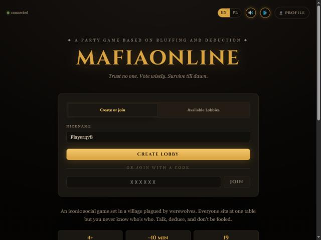

<div align="center">


# MafiaOnline

**Browser-playable Mafia / Werewolf — no install, no accounts needed to join.**

Players enter a 6-letter code, get assigned secret roles, and alternate between night phases (silent abilities) and day phases (public vote) until one faction wins.

[](https://github.com/Kubex212/MafiaOnline/actions/workflows/ci.yml)
&nbsp;
[](https://mafiaonline-production.up.railway.app)



</div>

---

## Screenshots

<!-- Replace with your own once captured -->
| Landing | Night phase | Day phase |
|:---:|:---:|:---:|
|  | _coming soon_ | _coming soon_ |

---

## Tech stack


| Layer | Details |
|---|---|
| **Backend** | ASP.NET Core 8, SignalR, EF Core + PostgreSQL |
| **Auth** | Discord OAuth2 + Google OAuth2, custom session tokens |
| **Frontend** | React 18 + TypeScript, built with Vite, served as static files |
| **i18n** | English + Polish (i18next) |
| **Logging** | Serilog — console + rolling file |
| **Tests** | xUnit |
| **Deploy** | Docker + Railway |

---

## Architecture

The project is split into two assemblies:

```
MafiaOnline.Engine/          ← pure C# domain library, zero ASP.NET deps
├── Core/                    ← Game aggregate + commands (Start, ResolveNight, ResolveDay…)
├── Roles/                   ← 19 role implementations
├── Night/                   ← NightResolver, NightContext, ability base classes
└── Day/                     ← DayResult, DaySession

Api/                         ← ASP.NET Core host
├── Controllers/             ← REST (Auth, Lobby, Night, Day, Me)
├── Hubs/                    ← SignalR LobbyHub
├── Services/                ← LobbyService, NightService, DayService, StatisticsService
├── Repositories/            ← PostgresLobbyRepository (lobby state as serialised JSON)
├── Middleware/              ← SessionMiddleware (token → ICurrentUser)
└── mafiaonline.frontend/    ← React SPA
```

The engine has no HTTP dependencies and can be unit-tested in isolation. `NightResolver` processes all submitted actions in priority order and handles cross-role interactions — Guardian blocks a Werewolf kill, Deceiver flips a Detective clue, Poacher trap fires before the attack lands.

---

## Game flow

```
Lobby → Night phase → Day phase → Night → Day → … → Game over
         (abilities)   (voting)
```

Night is simultaneous: every player with an interactive ability submits their action within the turn timer. Once all actions are collected (or the timer expires), `NightResolver` runs, kills and clues are computed, and results broadcast over SignalR. Day follows with open voting — plurality candidate is eliminated, win conditions checked.

**Roles by team**

| Villagers | Werewolves | Neutral |
|---|---|---|
| Villager, Guardian, Detective, DogTamer, Poacher, Trailer, Seer, Peeper, Spy, Ranger, Alchemist, Sorcerer, Innkeeper | Werewolf, Dracula, Deceiver, Ghost, Charmer | Fool |

---

## Running locally

**Docker Compose (recommended)**

```bash
cp .env.example .env      # add your Discord + Google OAuth credentials
docker compose up
```

App at `http://localhost:8080` — Postgres starts automatically and migrations run on startup.

**Without Docker**

```bash
# Prerequisites: .NET 8 SDK, Node 20, PostgreSQL

cd src/MafiaOnline/Api/mafiaonline.frontend
npm install && npm run build

cd ..
dotnet run
```

Credentials go in `appsettings.Development.json` or as environment variables — see `appsettings.json` for the key names and `.env.example` for the Docker env var equivalents.

**OAuth callback URLs**

| Provider | Callback |
|---|---|
| Discord | `http://localhost:8080/api/auth/discord/callback` |
| Google | `http://localhost:8080/api/auth/google/callback` |

---

## Tests

```bash
dotnet test src/MafiaOnline/MafiaOnline.sln
```

Covers the night resolver (kills, protection, traps, clue reversal), individual role abilities, and lobby JSON serialisation round-trips.
